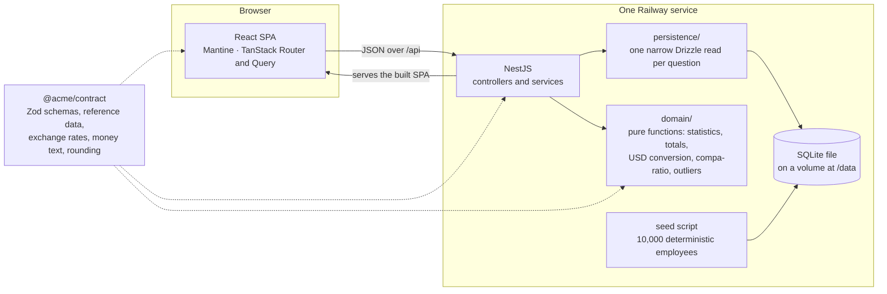

# ACME Salary Manager

A web app where ACME's HR Manager keeps the salaries of about 10,000 employees across seven countries, and answers four pay questions without a spreadsheet:

1. **Pay statistics:** what do we pay a given job title in a given country?
2. **Payroll totals:** what is the payroll total per country and per department?
3. **Cross-country comparison:** how does pay for one job title compare across countries?
4. **Outliers:** who is paid out of line for their job title in their country?

**Live:** <https://acme-production-08d3.up.railway.app>

The terms used here (peer group, compa-ratio, gap to 0.80, …) are defined in the glossary, [`CONTEXT.md`](CONTEXT.md).

## Contents

- [Architecture](#architecture)
- [Setup](#setup)
- [Commands](#commands)
- [Seed](#seed)
- [Endpoints](#endpoints)
- [Exchange rates](#exchange-rates)
- [Known limitations](#known-limitations)
- [How it was decided and built](#how-it-was-decided-and-built)

## Architecture



- **One service, one origin.** Nest serves the built React app and the API on the same port, so there is no CORS, one deploy, and the two apps can never run different versions ([ADR 0003](docs/adr/0003-api-contract-and-shared-types.md), [#7](https://github.com/daniel-bernardino747/acme-salary-manager/issues/7)).
- **SQL selects, the domain computes.** Each pay question is one narrow query whose rows go to one pure function. Every money rule (rounding, conversion, median, compa-ratio) lives once, in code that needs no Nest, database or network to test ([ADR 0002](docs/adr/0002-persistence-and-computation-seams.md#where-statistics-are-computed)).
- **One contract for both apps.** Every request and response body has a Zod schema in `@acme/contract`, and both apps use the types derived from them. The API validates every request with its schema, the HTTP tests parse every response with its schema, and the web forms build on the same employee schema. The package also holds the dated rate table ([ADR 0003](docs/adr/0003-api-contract-and-shared-types.md)).
- **Money is integer minor units plus a currency code**, never floats ([ADR 0001](docs/adr/0001-domain-model-and-money-rules.md)).

## Setup

You need:

- **Node 24.** The major version is pinned in [`.nvmrc`](.nvmrc) and in `engines`, so the local `better-sqlite3` binary matches the one Railway builds ([ADR 0002](docs/adr/0002-persistence-and-computation-seams.md#driver-and-data-access)).
- **pnpm 12.10.1**, pinned in `packageManager`. With Node 24's Corepack, `corepack enable` picks it up.

A pnpm workspace holds four packages: `packages/contract` (`@acme/contract`: reference data, exchange rates, Zod schemas and the money text functions, shared by both apps), `api` (NestJS, SQLite through Drizzle), `web` (React, Mantine, TanStack Query and Router) and `e2e` (Playwright).

```sh
pnpm install
pnpm build
```

`pnpm build` builds every package in dependency order, so `contract` is built before `api` and `web` ([ADR 0003](docs/adr/0003-api-contract-and-shared-types.md#build-and-module-format)).

### Development

```sh
pnpm dev
```

This runs `contract` in `tsc --watch`, the API in `nest start --watch` on port 3000, and Vite, which serves the web app and forwards `/api` to the API. Open the URL Vite prints.

- The API reads its database path from [`api/dev.env`](api/dev.env): `api/dev.db`, migrated on start but empty. To fill it with the default seed, run `pnpm build` once, then, from the repository root:

  ```sh
  DATABASE_PATH=dev.db pnpm --filter @acme/api seed
  ```

  The path is relative to `api/`, where pnpm runs the script.
- **A change to `contract` may need a restart of `pnpm dev`.** `tsc --watch` rebuilds `contract`'s `dist`, but the API in `nest start --watch` may keep running on the old one ([ADR 0003](docs/adr/0003-api-contract-and-shared-types.md#build-and-module-format)).

### A local production run

The same sequence Railway runs: migrate, seed with `--if-empty`, then serve. Nest serves the built web app and the API on one port.

```sh
pnpm build
DATABASE_PATH=/tmp/acme.db PORT=3000 pnpm start
```

Then open <http://localhost:3000>. The first start seeds the database before the server listens.

The app's only configuration is two environment variables: `DATABASE_PATH` (required, the SQLite file) and `PORT` (default 3000). The commands here use POSIX shell syntax, as in Git Bash. In PowerShell, set `$env:DATABASE_PATH` and `$env:PORT` first.

## Commands

All of them run from the repository root.

| Command | What it does |
|---|---|
| `pnpm test` | Every unit, seed, repository and HTTP test (Vitest, in `contract`, `api` and `web`). No browser, no network, no seed file: repository and HTTP tests run on `:memory:` databases ([ADR 0006](docs/adr/0006-testing-strategy-and-performance-measurement.md#test-layers)). |
| `pnpm test:e2e` | Builds the app, starts it with the Railway start sequence on a fresh temporary database, and runs the Playwright smoke test in Chromium. A trace is kept for a failed test, in `e2e/test-results/`. Install the browser once with `pnpm --filter @acme/e2e exec playwright install chromium`. |
| `pnpm perf <baseUrl>` | Times the employee list and each pay question against a running app (run `pnpm build` first). It writes [`docs/performance-results.md`](docs/performance-results.md), which is committed only from a run against Railway. It runs by hand, never in CI; how to run it against Railway is in [the performance note](docs/performance.md#running-it-against-railway). |
| `pnpm lint` | ESLint, then Prettier in check mode. `pnpm format` rewrites files with Prettier. |
| `pnpm typecheck` | `tsc` in every package, plus the Railway config. |
| `pnpm build` | Builds `contract`, `api` and `web`. |
| `pnpm start` | Migrate, `seed --if-empty`, then serve the built app (needs `DATABASE_PATH`). |

CI ([`.github/workflows/ci.yml`](.github/workflows/ci.yml)) runs lint, typecheck, `pnpm test` and a boot check of the built app on every push, and the end-to-end test in a separate job.

## Seed

The seed writes exactly 10,000 employees, the same ones on every run and on every OS, with outliers planted so that question 4 has a known answer. How it is built is in [ADR 0005](docs/adr/0005-deterministic-seed-data.md). Its headcount per job title and country and its base salaries are committed as generated snapshots: [`docs/seed/headcount-quotas.md`](docs/seed/headcount-quotas.md) and [`docs/seed/base-salaries.md`](docs/seed/base-salaries.md).

**The seed figures are illustrative: hand-picked to be plausible, not market data.**

It runs as a plain script on the built API (run `pnpm build` first), against the database in `DATABASE_PATH`:

```sh
DATABASE_PATH=/tmp/acme.db pnpm --filter @acme/api seed [--if-empty | --reset]
```

| Mode | On an empty table | On a table with employees |
|---|---|---|
| no option | seeds | refuses and exits with 1, pointing to `--reset` |
| `--if-empty` | seeds | does nothing and exits with 0. The start sequence uses this mode, so a restart never reseeds. |
| `--reset` | seeds | deletes every employee, restarts ids at 1, then seeds |

The reset and every insert run in one transaction, so a failed seed leaves the previous data in place. Every row is validated with the same schema as the API. The seed prints the row count, the database golden hash and how long it took. The seed tests pin that hash, so the same data on another machine prints the same hash.

### Reseeding on Railway

The deployed database lives on a Railway volume and survives restarts and deploys. To put it back to the default seed, for example after a demo that added or removed employees, open a shell in the running service from a directory linked to the project (`railway link`):

```sh
railway ssh
pnpm --filter @acme/api seed --reset
```

`DATABASE_PATH` is already set in the service, so the seed writes to the volume. The app keeps serving while it runs and shows the new data once the transaction commits.

## Endpoints

Everything is under `/api`, and both apps share the request and response schemas from [`@acme/contract`](packages/contract/src). There is no OpenAPI description: the endpoints are documented here by hand ([ADR 0003](docs/adr/0003-api-contract-and-shared-types.md#endpoints)).

| Method and path | Parameters | Success |
|---|---|---|
| `GET /api/employees` | query: `page`, `pageSize`, `q`, `country`, `department`, `jobTitle`, all optional | 200, one page |
| `GET /api/employees/:id` | path: `id` | 200, the employee |
| `POST /api/employees` | body: an employee | 201, the created employee, with a `Location` header |
| `PUT /api/employees/:id` | path: `id`; body: an employee (full replacement) | 200, the employee |
| `DELETE /api/employees/:id` | path: `id` | 204, no body |
| `GET /api/pay-statistics` | query: `jobTitle` and `country`, both required | 200 |
| `GET /api/payroll-totals` | none | 200 |
| `GET /api/pay-comparison` | query: `jobTitle`, required | 200 |
| `GET /api/outliers` | query: `page`, `pageSize`, `country`, `department`, `jobTitle`, `direction`, all optional | 200, one page |
| `GET /api/health` | none | 200, `{ "status": "ok" }` |

**Parameters**

- `id` is a positive integer. Ids are never reused, even after a removal.
- `country` is a code: `US`, `GB`, `DE`, `NL`, `IN`, `BR` or `JP`. `department` and `jobTitle` are names from the reference lists in [`reference.ts`](packages/contract/src/reference.ts), such as `Engineering` and `Software Engineer II`.
- `page` counts from 1 and defaults to 1. `pageSize` defaults to 25 and goes up to 100. A page past the end is a 200 with no items.
- `q` is a name search: each word matches the start of a word in the name, ignoring case and accents. Up to 100 characters.
- `direction` is `below` (underpaid) or `above` (overpaid). With `below`, the response also has the cost to reach 0.80 for every underpaid employee that matches the filters.
- Filters combine with AND. On outliers they narrow who is shown, never the peer group a median is taken over.
- Query parameters are strict: an unknown one, such as `?contry=IN`, is a 400.

**An employee** in a request body is `{ name, jobTitle, department, country, annualSalaryMinor }`. `name` is 1–100 characters once trimmed. `annualSalaryMinor` is the annual salary as a whole number of minor units (cents, paise; yen for JPY), greater than 0 and at most the cap in [`employee.ts`](packages/contract/src/employee.ts). There is no currency field: it follows from the country. In a response, the salary is `annualSalary: { amountMinor, currency }`, and the employee has its `id`.

**Money** is `{ "amountMinor": <integer>, "currency": "<ISO 4217 code>" }` on the wire, in requests and responses alike. USD figures are in cents. Every response with a USD figure also carries `rates: { source, asOf }`.

**A list page** is `{ items, page, pageSize, total }`. The outliers page adds `smallGroupHeadcount`, the employees matching the filters whose peer group is too small to check.

### Errors

Every error is an [RFC 9457](https://www.rfc-editor.org/rfc/rfc9457) Problem Details body, served as `application/problem+json`:

```json
{
  "type": "about:blank",
  "title": "Validation failed",
  "status": 400,
  "detail": "Request body is invalid",
  "errors": [
    { "path": ["name"], "message": "Required" },
    { "path": ["annualSalaryMinor"], "message": "Must be greater than 0" }
  ]
}
```

- **400:** a body, query or path parameter fails its schema. `errors[].path` is the path to the field, so the web app shows each message on its field.
- **404:** an unknown employee id, or an unknown `/api` route (still JSON, never the web app's HTML).
- **500**, or a deliberate 5xx: a generic body with no stack trace or SQL. The detail is logged on the server.

Every `/api` response also carries a `Server-Timing: app;dur=<ms>` header, which [`pnpm perf`](docs/performance.md) reads.

## Exchange rates

USD figures use a fixed exchange rate table shipped with the app, never a live feed. It comes from the **ECB euro foreign exchange reference rates for 2026-09-30**, fetched once by hand, with each rate **derived to USD** from the euro rates. The published figures, their source URL and the derivation are in [`exchange-rates.ts`](packages/contract/src/exchange-rates.ts), and a test pins a derived rate against one computed by hand from them. The app shows the source and date wherever it shows a USD figure.

## Known limitations

As recorded in the ADRs:

- **Name search is prefix-only:** "ller" doesn't find "Müller". `ß` isn't folded to `ss` ("gross" doesn't find "Groß"), and punctuation inside a name must be typed or replaced by a space ("oconnor" doesn't find "O'Connor", "o'connor" and "connor" do) ([ADR 0002](docs/adr/0002-persistence-and-computation-seams.md#name-search)).
- **Small groups reveal individual pay.** A peer group of one shows that person's salary as its statistics. That is acceptable while the HR Manager is the only user ([ADR 0001](docs/adr/0001-domain-model-and-money-rules.md#consequences)).
- **Money is shown and typed in `en` format only:** comma thousands separators and a decimal point ([ADR 0004](docs/adr/0004-ui-structure.md#copy-and-locale)).
- **SQLite on one Railway instance** means no replicas and a brief outage on each deploy. Needing more than one instance is the trigger for moving to Postgres ([ADR 0002](docs/adr/0002-persistence-and-computation-seams.md#consequences)).
- **The seed figures are illustrative, not market data** (see [Seed](#seed), and [ADR 0005](docs/adr/0005-deterministic-seed-data.md)).

What the MVP leaves out on purpose, and why, is in [the requirements](docs/requirements.md#out-of-scope-and-why).

## How it was decided and built

| What | Where |
|---|---|
| The requirements: scope, assumptions, what's out and why | [`docs/requirements.md`](docs/requirements.md) |
| The planning map: the decision areas, each settled in its own issue | [#1](https://github.com/daniel-bernardino747/acme-salary-manager/issues/1) |
| The spec: user stories and implementation decisions | [#10](https://github.com/daniel-bernardino747/acme-salary-manager/issues/10) |
| The spine: every ticket, in build order | [#9](https://github.com/daniel-bernardino747/acme-salary-manager/issues/9) |
| The glossary | [`CONTEXT.md`](CONTEXT.md) |
| ADR 0001: domain model and money rules | [`docs/adr/0001-domain-model-and-money-rules.md`](docs/adr/0001-domain-model-and-money-rules.md) |
| ADR 0002: persistence and computation seams | [`docs/adr/0002-persistence-and-computation-seams.md`](docs/adr/0002-persistence-and-computation-seams.md) |
| ADR 0003: API contract and shared types | [`docs/adr/0003-api-contract-and-shared-types.md`](docs/adr/0003-api-contract-and-shared-types.md) |
| ADR 0004: UI structure | [`docs/adr/0004-ui-structure.md`](docs/adr/0004-ui-structure.md) |
| ADR 0005: deterministic seed data | [`docs/adr/0005-deterministic-seed-data.md`](docs/adr/0005-deterministic-seed-data.md) |
| ADR 0006: testing strategy and performance measurement | [`docs/adr/0006-testing-strategy-and-performance-measurement.md`](docs/adr/0006-testing-strategy-and-performance-measurement.md) |
| The performance note: what is measured against the 500 ms target, and how | [`docs/performance.md`](docs/performance.md) |
| The performance results of the run against Railway, generated by `pnpm perf` | [`docs/performance-results.md`](docs/performance-results.md) |
| The Railway setup | [`.railway/README.md`](.railway/README.md) |
| The prompts given to the AI tools, phase by phase | [`docs/ai/prompts.md`](docs/ai/prompts.md) |
| Every AI session, saved as it ran | [`docs/ai/sessions/`](docs/ai/sessions/) |
